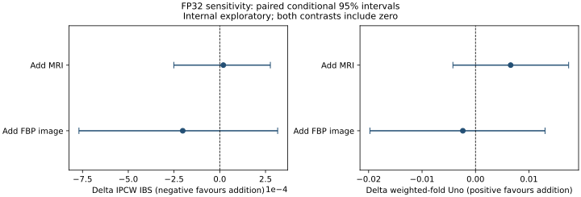

# Multimodal Alzheimer's Progression Research

**MRI + Amyloid/Tau PET + Clinical Data | 3D Deep Learning | Survival Analysis | Evidence-Traceable Evaluation**

**Can brain imaging improve predictions of future cognitive change beyond what clinical and cognitive assessments already tell us?**

That question drives this project. It brings structural MRI, amyloid PET, tau PET, and clinical/cognitive measurements into a carefully tracked research workflow for studying *future sustained Clinical Dementia Rating (CDR) progression*.

Training a sophisticated model is only part of the work. The harder part is checking whether the imaging adds useful information, how reliably the model performs, and what the results actually support. This repository includes the preprocessing, 3D models, survival analysis, matched comparisons, calibration, robustness checks, and reporting needed to investigate those questions.

> **Research status:** Internal, exploratory analyses using restricted A4/LEARN study data. This is research software, not a clinical diagnostic or decision-support system. No independent external validation has been completed.

## Latest fixed-prediction review checks (25 October 2026)

The [new addendum](analyses/final_review_20261025/README.md) retains the primary
results and adds a day 730–1095.75 error window for all 20 original matched
contrasts. All 20 adjusted intervals include zero. It also reconstructs subset
Kaplan–Meier nulls and IPA, exposes existing sex-specific diagnostics, verifies
all-draw within-fold concordance support, and checks preprocessing invariance
in 90 original component heads. These internal post-hoc checks do not establish
equivalence, external validity or a causal explanation of PET selection or tau
calibration. Jointly standardized and safely tuned pooled fusion remains
unevaluated. The addendum contains aggregate data and exact executed sources,
with an offline consistency checker and explicit restricted-data requirements.

## What this project delivers

- **More than a collection of models.** MRI, amyloid PET (FBP), tau PET (FTP), and prognostic fusion each have their own research track, backed by shared quality checks, evaluation tools, and reporting. The result is a connected research codebase rather than an isolated experiment.
- **A focus on what happens next.** The primary prognostic target is *sustained* CDR progression over time—not a one-time disease label. Survival models handle censoring explicitly; longitudinal PACC change is examined as a separate, secondary outcome.
- **A fair test for complex models.** Subject-grouped folds, inner-model selection, cross-fitted imaging predictions, and matched clinical baselines are used to ask a direct question: does adding imaging actually help?
- **Uncertainty is part of the analysis.** Beyond headline metrics, the study examines IPCW integrated Brier score, Uno's C-index, calibration, paired bootstrap comparisons (2,000 historically; 40,000 for the revised tau, three-year Brier and OOF analyses), scanner/manufacturer sensitivity, alternative endpoint definitions, and spatial attribution controls.
- **Results with a paper trail.** Source hashes, experiment contracts, result lineage, recorded exclusions, aggregate evidence, and an offline integrity checker make findings traceable without exposing participant-level information.

### By the numbers

| Research track | Recorded evaluation scale | Why it matters |
|---|---|---|
| MRI architecture experiments (Method X) | **1,336 participants**, five outer folds | Internal 3D MRI and hybrid architecture comparisons |
| Matched prognostic MRI analysis | **1,059 participants / 239 events** | Assessment of MRI features alongside clinical and amyloid predictors |
| Matched FBP-image prognostic analysis | **544 participants / 112 events** | Direct evaluation of image-derived PET information on its eligible subset |
| Focused FP32/post-fusion regression review | **63 tests reported passing** | Focused checks recorded in the precision-sensitivity and corrected evaluation review |
| Offline repository integrity verification | **Versioned file manifest** | A local hash check of the packaged source and aggregate evidence; see the verifier for the current count |

*These numbers describe different eligible analysis populations and checks. They are not a pooled cohort or a single four-modality model.*

## Findings worth examining

### 1. Regional MRI measures show notable associations with future progression

In an exploratory, covariate-adjusted regional analysis of **1,053 participants and 237 progression events**, baseline volumes showed the following associations with time to future CDR progression:

| Region | Hazard ratio per 1-SD log-volume increase | 95% CI | Holm-adjusted p-value |
|---|---:|---:|---:|
| Hippocampus | **0.720** | 0.597–0.867 | **0.00164** |
| Entorhinal cortex | **0.795** | 0.662–0.955 | **0.01427** |
| Lateral ventricle | **1.281** | 1.087–1.509 | **0.00632** |

These are *observed associations* in this cohort, not evidence that a brain region causes progression or that a model can locate Alzheimer's lesions. The original analysis flags diagnostic and stability limits; those qualifications remain important. [Read the regional analysis](reports/06_fusion/REGIONAL_EVIDENCE_FA.md).

### 2. A measurable result from the MRI architecture experiments

The internal Method X comparison evaluated scratch, partially fine-tuned, and hybrid 3D MRI approaches. In the recorded historical evaluation, the **hybrid dense-skip variant reached ROC-AUC 0.7185**, compared with **0.6785** for the hybrid baseline. It is a useful *technical comparison*, not a validated Alzheimer's classification result: in Method X, cohort identity and the target label are confounded. The dense-skip variant was also not selected by the recorded inner-selection rule. [See the complete Method X results](reports/03_method_x/thesis_method_x_v22_results_FA.md).

### 3. Testing the value of additional imaging

The reviewed FP32 sensitivity analysis recomputed imaging scores with frozen CNN weights, refitted the prediction heads within the recorded training ancestry, and compared models on **matched participants**.

| Matched comparison | Base IBS | With added imaging IBS | Paired difference (95% CI) |
|---|---:|---:|---:|
| Clinical + amyloid → add MRI (n = 1,059) | 0.040300 | 0.040319 | +0.000019 [−0.000251, +0.000276] |
| Clinical + MRI + amyloid → add FBP image (n = 544) | 0.040621 | 0.040418 | −0.000202 [−0.000770, +0.000316] |

**Lower IBS is better.** Both confidence intervals include zero: these matched comparisons **did not establish an additional predictive benefit** from MRI or FBP images. Recording that result is as important as reporting a favorable score. The intervals are conditional on the fitted models; they do not cover the uncertainty of running model selection and training again.



See the [full FP32 sensitivity review](docs/FP32_SENSITIVITY.md) for methods, precision-specific scope, and attribution checks.

## Statistical supplement added during thesis revision

The [11 October statistical supplement](docs/STATISTICAL_SUPPLEMENT.md) adds
analysis code and aggregate results for questions raised during thesis review:

- participant flow, demographics, availability-subset differences and tau timing;
- Kaplan–Meier follow-up summaries, a training-only null model and IPA;
- comparison with clinical baselines fitted on the complete outer training set;
- all three tau contrasts with multiplicity-adjusted intervals and calibration;
- a PACC sensitivity analysis using risk scores constructed without PACC or MMSE;
- retrospective sample-size scenarios and actual support for the tau heads.

The stronger clinical-plus-amyloid baseline reached IPA **5.84%**. Added MRI did
not establish a stable improvement. The risk–PACC association remained after
removing cognitive inputs from risk construction (interaction **−0.216 units/year
per SD risk**, 95% CI **[−0.285, −0.147]**). Tau findings remain exploratory and
calibration is unstable. These calculations use the original AMP parent and are
kept separate from the FP32 comparisons above.

See the [results report](reports/07_statistical_supplement/REPORT.md),
[eight aggregate evidence files](results/aggregate/10_statistical_supplement/), and
[analysis code](scripts/thesis_statistics_v1/). The guide records the post-hoc
status, exact reproduction requirements and remaining scientific limitations.
No participant-level files or signed thesis documents are included.

## Research update — 24 October 2026

The [new post-hoc analysis bundle](analyses/deepreview_revision_20261024/README.md)
adds training-only expert-score standardization, paired OOF tau concordance,
same-sample plasma/tau comparisons, nested frozen-component head tuning,
original fitted-head effective degrees of freedom, sparse-resampling policies,
and a four-summary deformation control in all 1,059 participants.

The score/tuning checks did not establish improved imaging prediction. The
220-person common sample did not establish tau or plasma superiority. The
deformation-summary control increased IBS relative to clinical-plus-amyloid
(ΔIBS +0.000531; K=2 adjusted interval +0.000074 to +0.001022).
Original primary estimates are retained, including null and adverse findings.
The [current result guide](docs/RESEARCH_UPDATE_20261024.md) explains estimands,
conditional intervals, changed aggregation sensitivity and reproduction limits.

The historical CNN/Jacobian pilot below remains a separate no-go experiment;
the new analysis is not a full-channel CNN or pretrained-encoder evaluation.
No external validation or complete A4 image-training reproduction is claimed.

## Research update — 14 October 2026

The [cumulative analysis bundle](analyses/reviewer_sensitivities_20261014/README.md)
adds the completed statistical work from the scientific review rounds, the
pooled OOF-stacking experiment and later precision/training-history audits.
It contains executable code, fixed aggregate outputs, dependency versions and
reproduction instructions. Manuscript text and editorial revisions are excluded.

| Research addition | What is now available |
|---|---|
| Statistical robustness | 40,000-draw tau and three-year Brier comparisons; calibration bands; IBS/IPA precision; longitudinal cognition; stronger clinical comparators; measured-censoring and modality-selection analyses |
| Pooled OOF stacking | Frozen-FP32-feature implementation, tests, all seven locked contrasts and a between-expert score-distribution diagnostic; 180 heads, no CNN retraining in this experiment |
| Concordance and training audit | Nominal absolute Uno-C intervals for 13 primary and 16 OOF/comparator entries; 405 original aggregate epoch histories |
| Compact CNN/Jacobian pilot | Equal-parameter T1 versus T1/log-Jacobian code, geometric and deterministic-GPU checks, versioned protocols and a no-go decision; no full-cohort experiment or numerical pilot results released |

**Updated interpretation:** all revised adjusted tau IBS intervals, all 20
adjusted three-year Brier intervals and all seven adjusted OOF IBS intervals
include zero. The two Cox-based tau ranking signals remain exploratory.
OOF score heterogeneity limits attributing changes to the head's training size.
The 14 October absolute concordance intervals are descriptive. The separate 24 October update adds paired tau-increment intervals and preserves their conditional scope.
These fixed-prediction analyses do not include model-development uncertainty or
independent-cohort validation. The CNN/Jacobian pilot failed its locked
advancement gate; it was not scaled to the full cohort.

The [analysis guide](docs/RESEARCH_UPDATE_20261014.md),
[pilot protocol and execution status](docs/CNN_JACOBIAN_PILOT.md), and
[file-level inventory](docs/RESEARCH_UPDATE_INVENTORY_20261014.json) distinguish
completed work, historical results and unperformed full-cohort work.
The 40,000-draw tau intervals supersede the 11 October supplement's older
2,000-draw intervals; that historical record is retained.

## Research workflow

| Research component | Implementation | Purpose |
|---|---|---|
| **MRI preprocessing and QC** | `scripts/preprocess_mri_spm.py`, `scripts/preprocess_mri_full.py` | Image preparation, spatial processing, and reproducible quality checks |
| **Method X: MRI technical experiments** | `scripts/mx_fasttrack_v2_4_4/`, `src/models/backbones/` | Evaluate 3D MRI encoders and hybrid architectures under the recorded study constraints |
| **Method Y: amyloid/tau progression** | `src/method_y_revival/`, `scripts/run_method_y_image_factorial_v4.py` | Separate FBP and FTP image-based survival experiments, factorial comparisons, and corrected selection analysis |
| **Prognostic fusion** | `scripts/xyz_fusion_v2/`, `scripts/run_xyz_fusion_v2.py` | Combine cross-fitted imaging predictions and clinical/cognitive features for future progression analysis |
| **Post-fusion evaluation** | `scripts/xyz_postfusion_final_v1/`, `scripts/xyz_fp32_spatial_v1/` | Matched inference, calibration, sensitivity, and numerical explanation checks |
| **Evaluation utilities** | `src/evaluation/` | Bootstrap intervals, calibration, threshold analysis, and XAI validation helpers |
| **Evidence and provenance** | `results/aggregate/`, `docs/`, `figures/` | Publicly inspectable *aggregate* summaries, lineage, and figures within this release |

The fusion study does **not** claim that MRI, FBP imaging, tau imaging, and blood biomarkers form a successfully estimated four-way model. These are distinct analysis routes with different eligibility and support constraints. The [active study map](docs/STUDY_MAP.md) identifies current entry points and required legacy compatibility code.

## Models and evaluation

The code includes 3D CNN and hybrid MRI backbones, discrete-time image survival networks, tabular survival baselines (Cox models and random survival forests), and fusion of imaging-derived risk estimates with clinical variables. Versioned configurations and experiment records preserve the history of each analysis, including corrections and superseded results.

The primary prognostic endpoint is the time to the **second qualifying CDR ≥ 0.5 observation on a distinct day**, within the recorded follow-up window. This definition is *not* equivalent to a dementia diagnosis. The evaluation framework addresses censoring, patient-level separation, fold-local preprocessing, conditional paired uncertainty, missingness, model calibration, and scanner/manufacturer effects.

Spatial attribution is treated as a **diagnostic of model behavior**, not proof of anatomical disease localization. In the reviewed FP32 panel, **36 of 66** numerical baseline checks passed; randomized-network controls were degenerate and label-permutation training was not completed. Those limitations are part of the result, not omitted from it.

## Repository structure

```text
analyses/          Frozen statistical/OOF implementation and aggregate evidence
configs/           Versioned experiment and analysis configurations
docs/              Study map, evidence lineage, data access, reproduction, and limits
figures/           Aggregate, privacy-safe evaluation figures
reports/           Method-specific results, review notes, and negative findings
results/aggregate/ Aggregate evidence projections (not individual predictions)
scripts/           Preprocessing, training, evaluation, and audit entry points
src/               Models, data handling, training logic, and evaluation utilities
tests/             Selected regression and contract tests
check_package.py   Standard-library-only integrity verifier
requirements.txt   Direct, version-pinned Python dependencies
```

## Getting started

**Inspecting this release does not require restricted study data or a GPU.** With **Python 3.11**, run the safe offline integrity check from the repository root:

```bash
python -B check_package.py
```

The verified package reports `PASS_PACKAGE_INTEGRITY_ONLY` when the listed files match their recorded hashes. This establishes package integrity **only**; it does not train a model, repeat the study, grant data-access permission, or certify scientific validity.

Reproducing the analyses requires more than installing packages. Researchers need approved access to the underlying A4/LEARN data, original locked predictions and folds where applicable, relevant image templates and tools, and the correct versioned experiment contracts. Several preserved runners are specific to the original Windows research environment. **Do not launch them against a new data tree without reviewing their contracts and output paths.**

Start with the [reproduction guide](docs/REPRODUCING.md), [data access requirements](docs/DATA_ACCESS.md), and [active routes](docs/STUDY_MAP.md). The pinned libraries are listed in [`requirements.txt`](requirements.txt); recorded versions and security caveats are documented separately in [`environment/`](environment/) and the [dependency security review](docs/DEPENDENCY_SECURITY.md).

## Limitations and research status

The completed experiments and accompanying audits provide a detailed internal research record. They also leave several important questions open:

- **No independent external validation:** findings are internal and exploratory; neither clinical deployment nor generalization has been established.
- **No confirmed incremental imaging gain in the reviewed FP32 comparisons:** paired confidence intervals include zero, and the comparisons use different eligible subsets.
- **Method X has cohort/label confounding:** its technical architecture metrics cannot establish disease-specific diagnostic performance.
- **PET quantification and cohort support are constrained:** pattern-normalized FBP/FTP images do not establish official Centiloid/CenTauR equivalence; sparse tau and joint-modality support prevents some comparisons, including the proposed four-way model.
- **Attribution remains incompletely validated:** some numerical controls failed or were not estimable, and full label-permutation testing was not performed.
- **Reproduction and release checks remain open:** end-to-end clean-machine reconstruction, final scientific promotion, licensing/citation decisions, and dependency security review are not complete.

For the complete evidence boundaries, see [release gaps](docs/RELEASE_GAPS.md), [negative findings](reports/06_fusion/NEGATIVE_RESULTS.md), and [evidence guidance](docs/EVIDENCE_GUIDE.md).

## Evidence, data access, and citation

This repository contains selected **source code, configurations, tests, aggregate results, and figures**. It deliberately excludes participant-level records, MRI/PET scans, individual predictions, model weights, and restricted identifiers. A GitHub repository does not itself grant permission to access or redistribute A4/LEARN data. Consult the [data access policy](docs/DATA_ACCESS.md) and the original provider's terms.

The project license and official software citation metadata are **not yet finalized**. Until the rights holder confirms those details, do not assume this is an open-source release. See [licensing](docs/LICENSING.md) and [citation status](CITATION_PENDING.md).

For a guided reading of the scientific record, begin with the [study map](docs/STUDY_MAP.md), [results index](docs/RESULTS_INDEX.md), and [report index](docs/REPORTS_INDEX.md).

---

**The contribution is a research process that can be inspected and challenged.** It tests multimodal predictions against meaningful baselines, records uncertainty, and keeps negative results visible. That makes the evidence more useful than a model score on its own.
