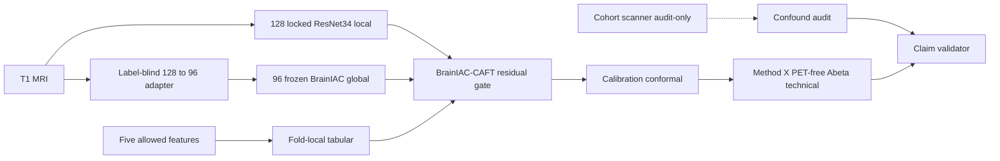

# Method X project roadmap (live, amended 2026-08-15)

A6 issued `READY_FOR_MAIN_BATTERY_TRAINING` on 2026-08-14. R0 full-text later
reached the scoping-review floor. This file is the live twin. Do not re-run
A6 `write_bundle` (it would restore R0 to `IN_PROGRESS`).

Machine-readable twin: `results/method_x_registry/project_roadmap.json`.

## Live architecture (Method X only)

PET never enters Method X — not in training, not in inference. The Aβ target
is PET-derived, so any PET input is circular. Cohort / site / scanner /
manufacturer / field strength are audit-only, never prediction or gate inputs.



Fusion order (do not skip ahead): unimodal baselines → frozen linear probes →
naïve concatenation → CAFT residual gated fusion → LoRA only after promotion.

The full programme chart (Method Y FBP/FTP, plasma, representation registry,
survival) lives in `docs/plans/method_x_brainiac_caft_implementation_20260808.md`
§7. Those branches are future MX-07 / R2 / R3 work, not Method X inputs.

## Live battery

Root: `results/final_results/method_x_model_battery_v3_depth_and_diversity_20260729`

| Model | Status | Notes |
|---|---|---|
| ResNet10 | `COMPLETED` | validation repaired; do not retrain |
| ResNet18 | `PAUSED_RESUMABLE_2_OF_5` | fold 2; resume C staging at optimizer step 1534 (H `fold_2_progress.pt` is stale at 1321) |
| ResNet34 | `PAUSED_RESUMABLE_3_OF_5` | fold 3, optimizer step 668 |
| DenseNet121 | `SMOKE_PASS` / not started | after ResNet34 |
| MedNeXt-S | `SMOKE_PASS` / not started | after DenseNet121 |
| ResNet50 / EfficientNet-B0 | `PROTOCOL_EXCLUDED_NOT_STARTED` | keep smoke reports |
| BrainIAC | post-hoc sixth family | R1a–R1c after five CNNs; not an official battery row |

Effective order: ResNet10 → ResNet18 → ResNet34 → DenseNet121 → MedNeXt-S.

- `G-A`: **READY** — next: resume ResNet18 fold 2 from C staging optimizer step 1534
- `R0`: **COMPLETE_SCOPING_REVIEW** — novelty still `NOVELTY_CANDIDATE`
- `R1`: **HARD_DISABLED** — vendor+weights on H; geometry/overlap/embeddings wait for battery
- `MX-03` … `MX-07`: **BLOCKED_DEPENDENCY_BATTERY_NOT_TERMINAL**

Accepted runtime overlay: full exact checkpoint every optimizer step on C NVMe;
H mirror at epoch; `maximum_deterministic_replay_steps=0`. Cadence-32 was not
promoted.

Live storage-locality blocker filename is `reports/BLOCKED_PREFLIGHT.json`.
The programme name `BLOCKED_STORAGE_LOCALITY.json` was never implemented; do
not create a duplicate file.

Agent closeouts before GPU resume must pass
`.\.venv\Scripts\python.exe scripts\run_method_x_repair_gate.py --phase authorize-resume`.
Missing layers or skipped pytest are BLOCK, never PASS. This gate does not
start training.

## Exact next command

Never `--no_resume`. You run GPU training; agents do not start it from this file.

```powershell
Set-Location -LiteralPath 'H:\New project'
.\.venv\Scripts\python.exe scripts\run_method_x_claim_benchmark.py `
  --mode resume-backbone `
  --backbone resnet18_3d `
  --output-root 'H:\New project\results\final_results\method_x_model_battery_v3_depth_and_diversity_20260729'
```

Success: no new `RESUME_CONTRACT_SOURCE_ONLY_MIGRATED` if the source digest is
unchanged; fold 2 continues from C staging at optimizer step 1534. If
`BLOCKED_*` appears again, do not skip to the next model. Do not prefer the
stale H `method_x_3d_fold_2_progress.pt` (still epoch 5 / step 1321).

Only after ResNet18 is 5/5 + metrics validation, `--mode run` continues
ResNet34 → DenseNet121 → MedNeXt-S.

## Do not do now

| Item | Why |
|---|---|
| Start GPU / 6213 embeddings / install `.venvs/brainiac` packages | Operator runs resume; R1a after five models |
| n=64 geometry / mask-edge on real cache | No GPU competition with MX-02 |
| Cadence-32 / replay | No bitwise MRI proof |
| Upgrade novelty / stamp paywalls | R0 ceiling (`NOVELTY_CANDIDATE`; s04/s16/s19/s23 unread) |
| Primary 128→96 adapter route | FOV `UNRESOLVED_PENDING_VENDOR`; path is `SENSITIVITY_ONLY` |
| Overlap → PASS | No upstream subject list = `UNKNOWN` |
| FBP inside Method X | Circular with PET-defined target |
| Method Y / survival / plasma / representation registry | Future chart; MX-07/R2/R3 |
| Rewrite locked v3 YAML, `--no_resume`, A6 `write_bundle` | Contract |

Post-training cards: `docs/plans/method_x_post_training_execution_memory_20260815.md`.
Remaining-work inventory: `docs/plans/method_x_remaining_work_20260815.md`.

2026-08-15 Method Y defect-repair session did **not** change this battery.
Ledger: `docs/plans/agent_session_ledger_20260815.md`.
Isolation note: `results/method_x_registry/SESSION_NOTE_METHOD_Y_DEFECT_REPAIR_20260815.json`.
